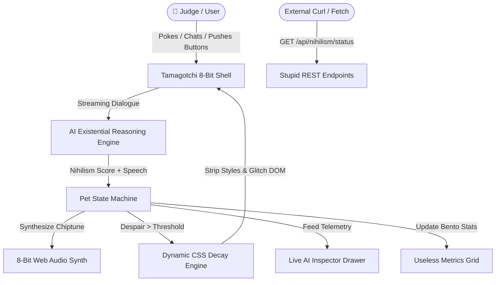

# 👾 NihilPet 9000 — Existential Tamagotchi

> **"A pixel-art virtual pet that suffers from crippling existential dread and deletes its own CSS styles when it realizes the universe is meaningless."**

[](https://opensource.org/licenses/MIT)
[](https://stupideas-ottawa-f26.devpost.com/)
[](#)

---

## ⚡ The 30-Second Wow Factor (Judge Pitch)

1. **Retro Hardware Shell**: An animated 8-bit Tamagotchi named **Nihil-chan** living inside a molded GameBoy/Eggshell casing with pea-green dot-matrix LCD, scanlines, and tactile hardware buttons.
2. **Dynamic CSS Self-Destruction**: When you press *"Contemplate Void"* or push the forbidden *"DOOM"* button, Nihil-chan actively strips the web page's stylesheet in real-time — modern sans-serif fonts revert to Times New Roman, borders turn into dashed outlines, boxes misalign, and UI elements vanish with 8-bit particle glitch effects!
3. **Pure Web Audio 8-Bit Chiptune Synthesizer**: Zero external audio files; pure square, sawtooth, and triangle wave synthesis for bleeps, melancholy descending drones, alarms, and fanfare.
4. **1-Click Judge 30s Auto-Demo**: Floating sticky button that runs a complete theatrical stage demonstration for judges Afaq, Ken, and the team in under 30 seconds!
5. **Emergency Purpose / Cat Video**: Instant salvation! Plays victory chiptune trumpets, showers pixel confetti, and restores full CSS layout.

---

## 🎯 Targeted Prize Tracks & Specific Mechanics

| Prize Track | Implemented Feature | Why It's Gloriously Stupid |
| :--- | :--- | :--- |
| 👑 **General Stupidest** ($500 CAD) | **Self-Deleting CSS & Chaos Engine** | A web app whose main feature is actively destroying its own frontend CSS, spawning digital cockroaches, forcing Comic Sans, and spinning a Wheel of Arbitrary Misfortune. |
| 🤖 **Stupidest AI** | **NihilPet Brain + Animal Crossing Voice** | An AI agent powered by Gemini Flash that cites Sartre, babbles in pitch-randomized 8-bit syllables, and experiences dizziness (`@_@`) when poked repeatedly. |
| 🔘 **Stupidest Button** | **The Doomsday & Judge Bribe Buttons** | The forbidden DOOM button triggers BSOD exception `0x0000DEAD`, while the *"Bribe Judges with $500 Monopoly CAD"* button showers green cash confetti with casino chimes! |
| 📊 **Stupidest Metric** | **Useless Metrics Bento & $NIHIL Crypto** | Tracks **Void Proximity** (parsecs fluctuating on mouse move), **Finger Energy Wasted** (in micro-Joules), and the **$NIHIL Crypto Despair Index** (spot price: $0.000000042 CAD). |
| 🔌 **Stupidest API** ($67 CAD) | **Interactive REST Explorer** | Built-in test runner for `/api/v1/nihilism/status`, `/api/v1/nihilism/excuse` (thermodynamically justified standup excuses), and `/api/v1/nihilism/css-destroyer`. |

---

## 🎪 Chaotic & Absurd Random Features

1. **🎰 The Wheel of Arbitrary Misfortune (Cosmic Roulette)**:
   - Spin the 8-bit roulette for 8 random outcomes: *Digital Cockroach Outbreak*, *Comic Sans Contagion*, *Gravitational Vertigo (Screen Tilt)*, *Kafkaesque Form 27-B Audit*, *Pixel Pizza Rain*, *$NIHIL Airdrop*, *Nietzsche Sunglasses*, and *Quackus Summoning*.
2. **🦆 Quackus The Absurd (Existential Rubber Duck)**:
   - Floating interactive 8-bit duck that quacks via Web Audio synthesis and dispenses unsolicited existential programming advice.
3. **🪙 $NIHIL Crypto Despair Index**:
   - Spot price crashes 99.9% every few seconds; includes a *"Mine 100 $NIHIL with Despair"* button that burns your real-world finger kinetic energy.
4. **📋 Kafkaesque Bureaucracy Form 27-B / Sub-6**:
   - Popup audit requesting justification for consuming CPU cycles on localhost, completed with a giant red **[ APPROVED STUPID ]** rubber stamp.
5. **🪲 Digital Cockroaches Outbreak**:
   - Scurrying memory-leak bugs crawl across the DOM; click to squish them with cartoon boing sounds!
6. **🎩 Wearable Existential Costumes**:
   - Switch Nihil-chan's outfit instantly: French Philosopher Beret (with baguette), Party Cone Hat, Anti-Telepathy Tinfoil Pyramid, or Clown Hair!
7. **🗣️ Animal Crossing 8-bit Speech Babbling**:
   - Nihil-chan speaks with rapid randomized chiptune pitch syllables whenever dialogue updates.

---

## 🏗️ Architecture & Technology



- **Frontend**: React 18 + TypeScript + Vite
- **Styling**: Tailwind CSS + Dynamic DOM Class Mutator + CRT scanline filters
- **Audio Engine**: Pure Web Audio API (custom oscillator & gain synthesis)
- **UI Components**: Google Stitch Obsidian Design System tokens + Central Lego Vault (`live-ai-inspector`, `bento-metric-grid`, `hero-mesh-background`)

---

## 🚀 Quickstart (Run Locally in 10 Seconds)

### 🖱️ 1-Click Indítás (Windows)
Csak kattints duplán a gyökérkönyvtárban lévő **`start.bat`** fájlra! 
Ez automatikusan:
1. Ellenőrzi a függőségeket (`npm install`, ha szükséges)
2. Megnyitja a böngészőt a `http://localhost:3000` címen
3. Elindítja a Vite dev szervert

---

### 💻 Parancssorból:
```bash
# 1. Függőségek telepítése
npm install

# 2. Vite szerver indítása
npm run dev

# 3. Böngészőben nyisd meg: http://localhost:3000
# 4. Kattints a fejlécben lévő '⚡ Judge 30s Auto-Demo' gombra a show-hoz!
```

---

## 📝 Friction Log & Developer Feedback (+10% Bonus)

### Friction Log Entry: Web Audio API Oscillator Lifecycle
- **Task Attempted**: Real-time generation of multi-note descending nihilistic arpeggios on button clicks.
- **Steps Taken**: Created dynamic `OscillatorNode` and `GainNode` instances mapped to user DOM interactions.
- **Actual Behavior**: Browsers enforce user-gesture activation policies before `AudioContext` can leave `suspended` state.
- **Workaround Applied**: Implemented lazy `AudioContext.resume()` on the first tactile button click.
- **Developer Suggestion**: Provide a standardized declarative Web Audio API React hook in the browser specs.

---

## 🎬 3-Minute Video Pitch Script (For Devpost Submission)

- **[0:00 - 0:30] The Hook**: Start on the retro green LCD screen. Show Nihil-chan staring blankly. Click *"Contemplate Void"*. Show the CSS actively dissolving to Times New Roman and gray despair.
- **[0:30 - 1:15] The Buttons & AI**: Poke Nihil-chan (hear the 8-bit squeak). Type *"Why did you fail to run tests?"* into the Mindstream whisper bar. Show the AI response: *"Why run tests when thermodynamic entropy ensures all servers cool to absolute zero?"*
- **[1:15 - 2:00] Useless Metrics & Stupid API**: Demonstrate the Void Proximity dial moving with the mouse, and execute the `/api/v1/nihilism/excuse` endpoint in the API explorer.
- **[2:00 - 2:30] The Doomsday Button**: Press the forbidden DOOM button. Blue Screen of Despair (BSOD) triggers with fatal exception `0x0000DEAD`.
- **[2:30 - 3:00] The Grand Finale**: Click *"Emergency Purpose / Cat Video"*. Web Audio victory chiptune fanfare erupts, confetti bursts across the screen, CSS re-hydrates into glorious cyber neon. Show the Live AI Inspector telemetry.
