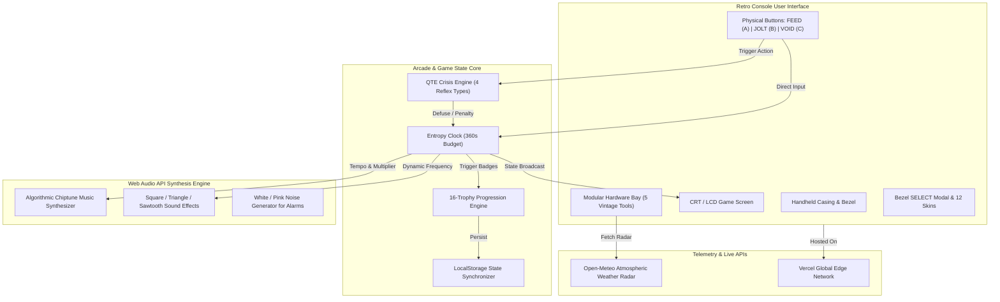

# 👾 NihilPet 9000 — Existential Retro Virtual Pet Console

<div align="center">

<!-- Sweetbanner Animated Interactive SVG Banner -->
<a href="https://nihil-pet.vercel.app">
  
</a>

<br/>

<p align="center">
  <b>A cursed 8-bit virtual pet simulation running in an entropy-driven desktop retro console.</b><br/>
  Combines urgent arcade quick-time reflexes, modular vintage hardware bays, and 100% procedural Web Audio synthesis.
</p>

<p align="center">
  <a href="https://nihil-pet.vercel.app"></a>
  <a href="https://github.com/barnabas47/NihilPet/stargazers"></a>
  <a href="https://github.com/barnabas47/NihilPet/blob/main/LICENSE"></a>
</p>

<p align="center">
  <a href="https://react.dev/"></a>
  <a href="https://www.typescriptlang.org/"></a>
  <a href="https://vitejs.dev/"></a>
  <a href="https://tailwindcss.com/"></a>
  <a href="https://developer.mozilla.org/en-US/docs/Web/API/Web_Audio_API"></a>
</p>

</div>

---

## 🕹️ Instant Play Online (Zero Installation Required!)

### 👉 **[https://nihil-pet.vercel.app](https://nihil-pet.vercel.app)**

> **No downloads, no installations, no logins.** Simply launch in any desktop or mobile browser to boot up the vintage molded casing, turn on the ignition switch, and keep your existential pixel pet alive against relentless entropy!

---

## 📟 Terminal Telemetry Readout (GitAscii Broadsheet)

```
┌─────────────────────────────────────────────────────────────────────────────────────────────────┐
│ NIHILPET-9000 // OPERATIONAL FIRMWARE v0.9.1b                   [STATUS: LIVE | VER. CERTIFIED] │
├─────────────────────────────────────────────────────────────────────────────────────────────────┤
│                                                                                                 │
│   ( \___/ )      [CONSOLE TELEMETRY]                    [ARCADE STATE]                          │
│   ( •  • )       ├── CPU Core: React 18 Concurrent      ├── Entropy Clock: 360s Countdown       │
│   (  ---  )      ├── Audio DSP: Web Audio Oscillators   ├── Heartbeat Rate: 78 -> 145 BPM       │
│   ( |   | )      ├── Color Palettes: 6 Vintage Modes    ├── QTE Reflex Alarm: ARMED [READY]     │
│   (_|___|_)      └── Persistence: LocalStorage Sync     └── Active Multiplier: x1.85 (Streak)   │
│                                                                                                 │
│ ┌─[MODULAR HARDWARE ACCESSORY BAY]──────────────────┐ ┌─[ACTIVE QUICK-TIME PROTOCOL]──────────┐ │
│ │ • Wave Oscilloscope : Live synthesized sine wave  │ │ [!] CRISIS: 3.3V SHORT CIRCUIT        │ │
│ │ • 8-Bit Calculator  : Functional arithmetic unit  │ │ [!] REMEDY: Hit [JOLT] within 3.5s    │ │
│ │ • Weather Radar     : Open-Meteo real-time radar  │ │ [!] PENALTY: -25s entropy clock drain │ │
│ │ • Cursed Crypto     : Fluctuating $NIHIL ticker   │ │ [!] REWARD : +15s life & +1,200 PTS   │ │
│ │ • Somatic EKG       : Real-time pulse waveform    │ │ [!] STATUS : [ ████████░░░░ ] 2.1s    │ │
│ └───────────────────────────────────────────────────┘ └───────────────────────────────────────┘ │
│                                                                                                 │
│ SYS_LOG> Web Audio context initialized @ 44.1kHz • Chiptune town melody synthesized smoothly... │
└─────────────────────────────────────────────────────────────────────────────────────────────────┘
```

---

## 💥 The Problem: The Virtual Pet Paradox

Traditional virtual pet simulations (Tamagotchi, Neopets) suffer from two fatal design flaws:

```
    [ ENDLESS TRIVIAL CHORES ]                  [ ZERO REAL DAKES / INDIFFERENCE ]
                \                                          /
                 \                                        /
                  \---> [ PLAYER APATHY & BOREDOM ] <---/
                                     |
                                     v
                       [ EXISTENTIAL NIHILISM ]
```

1. **Repetitive Chore Treadmill**: Pets demand feeding and cleaning on static schedules, presenting zero cognitive or reflex challenges.
2. **Absence of Real Urgency**: Neglect is slow and uneventful; there are no reflex-testing crises or tactile hardware interactions.
3. **Bloated Asset Loads**: Most web remakes rely on multi-megabyte soundbanks, spritesheets, and heavyweight engines, ruining initial load times.

---

## 💡 The Solution: NihilPet 9000 Retro Console

**NihilPet 9000** completely reinvents the genre as a fast-paced, high-stakes arcade survival console running on a molded vintage GameBoy shell:

- **Strict Entropy Countdown Budget (6-Minute Operational Cycle)**: Every second ticks down your pet's existential clock. Maintain balance ($\le 15\%$ entropy) for **Pixel Nirvana**, or succumb to **Entropy Collapse** with an interactive autopsy dossier.
- **Urgent Quick-Time Events (QTE Engine)**: Dynamic panic crises trigger every 20–30 seconds with urgent alarms, requiring split-second button reflexes before clock penalties strike.
- **Left Modular Hardware Bay**: Seamlessly switch between a live sound wave oscilloscope, an 8-bit pocket calculator, live global weather radar, a fluctuating crypto ticker, and an EKG heart monitor.
- **Zero External Audio Assets**: 100% of the Pokémon-style chiptune music, button bleeps, crunch sounds, and alarm sirens are mathematically generated in real time using browser Web Audio API oscillators.

---

## ⚡ Core Technical Innovations

| Feature | Technical Implementation | Gameplay & Architectural Impact |
| :--- | :--- | :--- |
| **Urgent QTE Arcade Engine** | State machine with microsecond precision timeouts, progress interpolation, and combo streak multipliers | Elevates idle pet care into an exhilarating reflex trial (Starvation, Choking, Short Circuits, Dimensional Tears) |
| **Procedural Web Audio Synth** | Pure Web Audio API (`AudioContext`, `OscillatorNode`, custom ADSR envelopes, noise generators) | Zero external audio MP3/WAV files required; 0ms asset latency; algorithmic Pokémon-style 8-bit BGM |
| **Modular Hardware Accessory Bay** | Dynamic component drawer with isolated lifecycle hooks and canvas renders | Features Oscilloscope, 8-Bit Arithmetic Calculator, Open-Meteo REST API Weather Radar, $NIHIL Ticker, and EKG Monitor |
| **6 Retro LCD Color Palettes** | Dynamic CSS variable mapping with retro phosphor and LCD scanline overlays | Authentic recreation of GameBoy DMG Pea Green, Pocket Gray, Virtual Boy Crimson, Cyberpunk Cyan, Amber CRT, and Matrix Emerald |
| **16 Unlockable Trophies & Wardrobe** | LocalStorage state engine with Steam-style glassmorphic toast notifications | Unlocks 12 unique achievement-gated skins (Astronaut, Wizard, Party Cone, Crown, Tinfoil) |
| **CRT & RF Static Noise Shader** | Canvas-based per-frame procedural grain generator with chromatic aberration | Delivers vintage analog tube television immersion with zero external texture overhead |

---

## 🧩 System Architecture



---

## 🎮 Arcade Crises (Quick-Time Events)

During the survival session, urgent crises randomly strike:

1. **🍕 Ravenous Starvation**: Spam the **FEED** button 5 times within 4.5s or suffer a **-22s** clock penalty!
2. **🤢 Asphyxiation Choke**: Rapidly Heimlich-poke 4 times within 4.0s or lose **-20s**!
3. **⚡ 3.3V Short Circuit**: Instantly hit **JOLT** to ground the arc within 3.5s or lose **-25s**!
4. **🌀 Dimensional Tear**: Hit **VOID** to anchor the continuum within 3.5s or lose **-18s**!

*Successfully defusing a QTE rewards **+15s** entropy life and **+1,200 points**!*

---

## 🛠️ Quick Start & Local Development

### Prerequisites
- [Node.js](https://nodejs.org/) (version 18+ recommended)
- `npm` or `pnpm`

### Local Setup
```bash
# 1. Clone the repository
git clone https://github.com/barnabas47/NihilPet.git

# 2. Enter project folder
cd NihilPet

# 3. Install dependencies
npm install

# 4. Start local Vite development server
npm run dev
```

Open your browser at `http://localhost:3000` or `http://localhost:5173`.

### Production Build
```bash
npm run build
npm run preview
```

---

## 📂 Project Structure

```
NihilPet/
├── docs/
│   └── assets/
│       ├── animated_sweetbanner.svg    # Self-contained animated SVG broadsheet banner
│       └── nihilpet_icon.png           # Flat vector portfolio icon
├── src/
│   ├── components/
│   │   ├── AchievementModal.tsx        # 16-Trophy Compendium viewer
│   │   ├── AchievementToast.tsx        # Steam-style pop-up notifications
│   │   ├── BsodModal.tsx               # Blue Screen of Death terminal modal
│   │   ├── CrtStaticNoise.tsx          # Real-time procedural CRT RF static noise
│   │   ├── DigitalBugs.tsx             # Glitch critters & screen artifacts
│   │   ├── HardwareUtilityBay.tsx      # Modular 5-tool accessory selector
│   │   ├── LeftHardwarePanel.tsx       # Oscilloscope, Calculator, Weather, EKG
│   │   ├── NihilPetSprite.tsx          # 8-bit procedural pixel pet rendering
│   │   ├── RightTelemetryPanel.tsx     # Session clock, scoring & multiplier telemetry
│   │   ├── TamagotchiDevice.tsx        # Physical console shell & button controllers
│   │   └── WardrobeModal.tsx           # 12 Skins & 6 LCD palette switcher
│   ├── hooks/
│   │   └── useCssDecay.ts              # Procedural CSS corruption hooks
│   ├── lib/
│   │   ├── achievements.ts             # Trophy definitions & unlock conditions
│   │   ├── soundEngine.ts              # Pure Web Audio API algorithmic synth
│   │   └── types.ts                    # Global TypeScript interfaces
│   ├── App.tsx                         # Master session coordinator & state machine
│   ├── index.css                       # Retro typography, scanlines & tailwind base
│   └── main.tsx                        # Application mount point
├── vercel.json                         # Vercel SPA deployment configuration
├── vite.config.ts                      # Vite build configuration
└── package.json                        # Project dependencies & scripts
```

---

## 🌐 Instant Online Deployment

### Vercel (Recommended 1-Click)
1. Fork or import this repository on [vercel.com](https://vercel.com).
2. Click **Deploy**. Everything is pre-configured in `vercel.json`.

### GitHub Pages
1. Go to **Settings** -> **Pages** in your repository.
2. Under **Build and deployment**, select **GitHub Actions**.
3. Push to `main` branch to trigger automated deployment via `.github/workflows/deploy.yml`.

---

## 📜 License & Credits

Created by **Buzás Barnabás** ([@barnabas47](https://github.com/barnabas47)).  
Distributed under the **MIT License**. See `LICENSE` for details.
