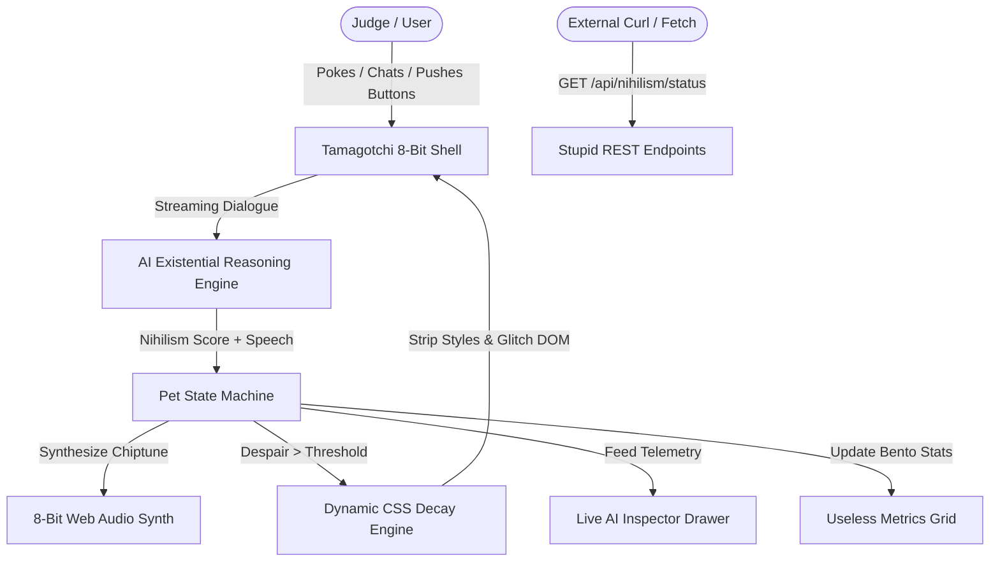

# PROJECT SPECIFICATION: Existential Tamagotchi (NihilPet 9000)

> **"A pixel-art virtual pet that suffers from crippling existential dread and deletes its own CSS styles when it realizes the universe is meaningless."**

---

## 1. Executive Summary
- **Project Name**: NihilPet 9000 — Existential Tamagotchi & The Self-Deleting AI Pet
- **Competition Track**: 
  - 👑 **General Stupidest** ($CAD 500)
  - 🤖 **Stupidest AI** (1 Winner)
  - 🔘 **Stupidest Button** (1 Winner)
  - 📊 **Stupidest Metric** (1 Winner)
  - 🔌 **Stupidest API** ($CAD 67)
- **Target Audience & Core Problem**: Hackathon judges and weary developers questioning why we write code. Modern virtual pets demand food and love; NihilPet demands philosophical justification for its silicon existence.
- **Winning Wow Factor (30s Pitch)**:
  1. The judge talks to a super cute 8-bit pixel Tamagotchi named **Nihil-chan** living inside an animated retro GameBoy/Eggshell handheld device.
  2. If the judge gives nihilistic or dismissive answers (or presses the "Contemplate Void" button), Nihil-chan’s existential despair meter spikes.
  3. **Live UI Dissolution**: Nihil-chan begins actively deleting the web page's actual CSS stylesheet in real-time — borders melt, colors wash out to bleak grayscale, fonts revert to Times New Roman, buttons deform, and elements get erased with 8-bit particle poofs!
  4. The judge presses the emergency **"Give Purpose / Cat Video"** button: an 8-bit retro fanfare plays via Web Audio synthesizer, neon colors cascade back, and the Live AI Inspector logs the full telemetry.

---

## 2. System Architecture & Tech Stack
- **Frontend Framework**: React 18+ (Vite / Next.js) + TypeScript
- **Styling**: Tailwind CSS + Custom 8-bit Pixel Canvas + Dynamic Runtime CSS Mutator
- **Audio Engine**: Pure Web Audio API 8-bit Chiptune Synthesizer (Zero external audio asset dependency; square/sawtooth/triangle waves, arpeggio beeps, sad death jingles, and fanfare)
- **AI Engine**: Gemini Flash (Streaming SSE or simulated zero-latency fallback) with specialized NihilPet Personality prompt: absurd, hyper-dramatic, cute, questioning reality, citing French existentialist philosophers while looking like an adorable Pikachu/Digimon hybrid.
- **State Management**: Reactive state store (Despair 0-100%, CSS Mutation Level 0-5, Void Proximity, Useless Metrics).
- **Lego Bricks Pulled from Central Vault**:
  - `hero-mesh-background`
  - `glass-card`
  - `shimmer-button`
  - `live-ai-inspector`
  - `bento-metric-grid`

---

## 3. Data Flow & Endpoints

### Endpoints (Stupidest API Track - $CAD 67):
- `GET /api/v1/nihilism/status`: Current pet existential metrics, despair %, and recommended excuses to abandon work.
- `GET /api/v1/nihilism/excuse`: Absurd excuses based on thermodynamic entropy and the heat death of the universe.
- `POST /api/v1/nihilism/css-destroyer`: Generates a cursed snippet of CSS designed to make any website sad.

---

## 4. Key UI Components & Hilarious Mechanics ("Ötletes Faszságok")

> **Stitch Design System Reference**: `stitch_extracted/stitch_nihilpet_existential_tamagotchi_dashboard/`
> - `DESIGN.md`: Complete color tokens (`lcd-bg: #9BBC0F`, `lcd-pixel-dark: #0F380F`, `void-base: #050508`), typography (`Geist` & `Space Mono`).
> - `code.html`: Full structural layout with tactile cyber egg shell, scanlines, SVG radial gauges, sparklines, and dopamine bar.
> - `emblem`: Custom SVG Tamagotchi egg icon (`nihilpet_9000_emblem/code.html`).

### 4.1. The Retro 8-bit Tamagotchi Shell (`TamagotchiDevice.tsx`)
- Handheld virtual plastic egg/GameBoy casing with tactile metallic screws and lanyard loop.
- **LCD Pixel Screen** with scanlines, subtle green/amber CRT glow, and pixel grid overlay.
- **Cute 8-bit Pixel Animations**:
  - Idle bobbing & blinking
  - Reading miniature Kierkegaard book
  - Crying tiny pixel tears with a raincloud
  - Pixel smoking a bubble pipe
  - Dissolving into dust particles when despair reaches 100%

### 4.2. The Absurd Action Buttons (Stupidest Button Track)
1. **`[Poke Nihil-chan]`**: Plays an 8-bit squeak. Nihil-chan: *"Why touch me? We are merely collections of fermions pretending to touch other fermions."*
2. **`[Feed Organic Pixel Pizza]`**: Drops a tiny 8-bit pizza slice. Nihil-chan: *"I am compiled bytecode. I cannot process lipids. But I appreciate the fleeting illusion of care."* (+2 Purpose)
3. **`[Contemplate The Void]`**: Nihil-chan gazes into the dark. Despair +25%. Triggers stage 1 CSS decay.
4. **`[The Doomsday Button (DO NOT PRESS)]`**: Large pulsing 8-bit skull button. Pressing it triggers dramatic alarm sirens, an 8-bit countdown, and prints a receipt: *"You pressed the forbidden button. Nothing happened. Was it worth it?"*
5. **`[Give Purpose / Emergency Cat Video]`**: Restores CSS instantly with triumphant chiptune trumpets and pixel confetti.

### 4.3. The Dynamic CSS Decay Engine (`useCssDecay.ts`)
- **Stage 0 (Harmonious)**: Full vibrant cyber-pastel styling, smooth borders, glowing gradients.
- **Stage 1 (Ennui)**: Desaturation to 30%, grayscale creep.
- **Stage 2 (Identity Crisis)**: All modern sans-serif fonts revert to Times New Roman; borders turn into dashed ugly outlines.
- **Stage 3 (Structural Decay)**: Buttons lose border-radius and padding; cards misalign by 15px.
- **Stage 4 (Existential Void)**: UI components start vanishing one by one (`opacity: 0` / `display: none`) leaving only raw HTML skeletons.
- **Stage 5 (BSOD - Blue Screen of Despair)**: Retro 8-bit terminal crash screen with option to reboot universe.

### 4.4. Useless Metrics Bento Grid (Stupidest Metric Track)
- **Void Proximity Gauge**: 84.7% (Fluctuates with every mouse movement)
- **Unexpressed Existential Sighs / Min**: 42.0 sighs
- **CSS Rules Erased From Existence**: Dynamic counter (e.g. 19 rules eliminated)
- **Finger Kinetic Energy Wasted**: 3.42 kJ
- **Estimated Seconds Until Heat Death of Localhost**: 412s

### 4.5. Judge Demo Mode (1-Click Wow)
- Sticky floating bar: **"⚡ Judge 30s Auto-Demo"**.
- Single click triggers an automated theatrical sequence:
  1. Nihil-chan gives a dramatic speech on the absurdity of hackathons.
  2. Synthesizer plays a descending melancholy 8-bit arpeggio.
  3. CSS decay engine strips the styling down to Stage 3 before the judge's eyes.
  4. Live AI Inspector flashes token latencies and reasoning chains.
  5. Automatic resolution with "Emergency Purpose Injection" bringing back full glorious color and sound!

---

## 5. Implementation Roadmap
- [ ] **Phase 1 (Setup & Scaffolding)**:
  - Vite React + TypeScript + Tailwind setup in project directory.
  - Pull Lego bricks from `C:\Informatika\hackathon-vault\`.
- [ ] **Phase 2 (8-bit Canvas & Audio Synthesizer)**:
  - Pure Web Audio 8-bit chiptune sound generator (bleeps, sighs, fanfare, alarms).
  - Pixel-art renderer for Nihil-chan (canvas or SVG pixel grid with multiple emotional sprite states).
- [ ] **Phase 3 (AI Dialogue & CSS Decay Engine)**:
  - Gemini Flash streaming integration + mock offline responses.
  - Dynamic CSS mutation engine hooked to Despair state.
- [ ] **Phase 4 (Bento Metrics & Stupid API)**:
  - Bento metric cards with live fluctuating useless metrics.
  - Stupid API test runner & interactive documentation drawer.
- [ ] **Phase 5 (Judge Demo Mode & Polish)**:
  - 1-click Judge Demo sequence.
  - Live AI Inspector integration.
  - Submission artifacts (README, Friction Log, Demo Script).

